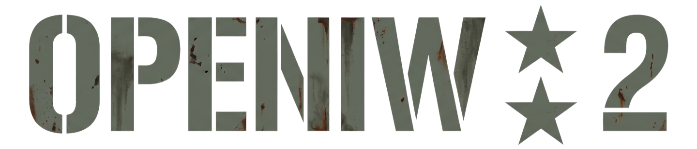

<p align="center">
  
</p>

# OpenIW2

OpenIW2 is a native engine for macOS on Apple Silicon (C++20, SDL3, Metal) that runs the **Call of Duty 2** campaign
and multiplayer from the game files of **your own retail copy**. It was written from scratch, without the
original source code. The behavior of the original game was studied, written down as specs in plain English, and then
reimplemented from those specs.

> **Status: playable, under active development.** Bugs may occur, and some details still differ from the original.
> Bug reports are welcome in [Issues](../../issues). See [Status](#status) for what works.

**Just want to play?** Jump to [Play](#play). **Want to build it?** See [Build from source](#build-from-source).

## Play

### What you need

- A Mac with Apple Silicon (M1 or newer) and macOS 14 or later.
- Your own copy of **Call of Duty 2** for PC, updated to **patch 1.3**. OpenIW2 uses its game files; it does not
  include any. You need the game's `main` folder (about 3.4 GB).

### 1. Install OpenIW2

1. Download `OpenIW2-<version>.dmg` from the [Releases](../../releases) page.
2. Open the DMG and drag **OpenIW2** into **Applications**.
3. The app is not notarized by Apple, so macOS blocks it at first ("cannot be opened" or "is damaged"). Open the
   **Terminal** app, paste this line and press Return (it asks for your Mac password):

   ```bash
   sudo xattr -r -d com.apple.quarantine /Applications/OpenIW2.app
   ```

   This removes the "downloaded from the internet" mark from OpenIW2 only. You need to do it once per downloaded
   version.

### 2. Copy your game files

Copy the `main` folder of your installed, patched game to your Mac, for example into your Documents folder. On
Windows it is inside the game's install folder (usually `C:\Program Files\Activision\Call of Duty 2\main`). It
contains files named `iw_00.iwd` … `iw_15.iwd` and `localized_<language>_iw00.iwd` … for your language.

### 3. Start the game

Open **OpenIW2** from Applications. On the first start it asks you to choose your `main` folder, checks that all
needed files are there, and remembers the folder. If something is missing, it tells you which files.
It starts in the game's main menu. Your profiles and saved games are kept in
`~/Library/Application Support/OpenIW2/`, so your `main` folder is never changed. A log of the last two starts is in
`~/Library/Logs/OpenIW2/` (`openiw2.log` and the four previous starts, `openiw2-1.log` to `openiw2-4.log`); attach it when you report a problem.

The language follows the localized files in your `main` folder. The controls are the game's own defaults; `Esc`
opens the pause menu. `F12` shows or hides a frame rate counter in the top right corner (always available, not a cheat).
`F11` saves a screenshot (JPEG) of the frame as displayed — scene and HUD at the window size — into
`~/Library/Application Support/OpenIW2/screenshots/` (`shot0000.jpg`, `shot0001.jpg`, …; the game's original
screenshot key was F12, which OpenIW2 uses for the counter). The key can be changed in the controls menu, like every
other key.

OpenIW2 adds its own options page, **Options > OpenIW2** (in the single-player and the multiplayer options menu):

- **Hit marker** (off by default). When on, the multiplayer hit marker (a small X next to the crosshair, fading in about a second,
  no sound) shows whenever you damage an enemy soldier, also when you fire a mounted gun or a flak gun and when you hit the distant
  running soldiers some levels show (drones). With the value **Red on kill** the X turns red when your hit killed the soldier or
  dropped a drone (multiplayer always shows it white).
- **Cheats** (single player only, off by default): turns `sv_cheats` on for the mission and unlocks the developer keys described under
  Cheats below. The row is not in the multiplayer menus, and in a multiplayer or network game the keys never work, whatever the option says.

Both are saved in your profile.

Options that would do nothing in OpenIW2 are hidden from the settings pages: the texture filter (always anisotropic, at the highest
level the GPU supports), renderer, SLI, shadows, aspect ratio (the view follows the window shape), sound quality and sound card. Of
the remaining original options, the console and the video mode and refresh rate do nothing (the window
keeps its size; resize it yourself). **Sync every frame** is on by default in OpenIW2 (the original starts with it off and no
frame limit). **Anti-aliasing** works and defaults to 4x (the original defaults to off); it also smooths alpha-tested textures, and a
change applies at the next start.

### Multiplayer

**Multiplayer** in the main menu switches to the multiplayer menus inside the same app.

- **Start new server**: pick the gametype (Deathmatch, Team Deathmatch, Search and Destroy, Capture the Flag,
  Headquarters) and the map; the gametype's settings page sets its score and time limits. The extra
  **Bots & weapons** page (an OpenIW2 addition; the original game has no bots) sets the number of bots (0–15),
  their skill (easy to veteran) and which weapon classes are allowed: rifle, bolt, sniper, smg, mg, shotgun and
  grenades, in any combination that leaves every nation a primary weapon (one that does not is refused with a
  message). **Start** loads the map and hosts a listen server that always accepts players from your local network;
  there is no extra switch to turn on. It uses UDP port 28960, or the next free one (up to 28969) when another
  server on the same Mac already has it; the server list on the other computers looks at ports 28960 to 28963.
  If the macOS firewall is on, the first start asks whether OpenIW2 may accept incoming network connections:
  choose **Allow**. Until that is answered, and after **Deny**, the other computers do not see the server at all.
  OpenIW2 is not signed by a registered developer, so macOS may ask again after an update; if friends cannot see
  your server, open System Settings, Network, Firewall, Options and check that OpenIW2 is set to allow incoming
  connections (remove it with **-** and start a server again to get the question back).
- **Dedicated server**: with **Dedicated** set to LAN or Internet (both are the same here, there is no master
  server), **Start** closes the game window and opens a server console window instead: the server runs with the
  chosen map, gametype, settings, bots and weapon classes, but without a player of its own. The window shows the
  server log and has a command line for the server console (`status`, `map <name>`, `map_rotate`, `kick <name>`,
  `say <text>`, `set <cvar> <value>`, `quit`, ...); the up and down arrows recall earlier commands, Page Up / Page
  Down and the mouse wheel scroll the log. Closing the window (or `quit`) stops the server and the app. rcon works
  once `rcon_password` is set (for example `set rcon_password <password>` in the console window). Started from
  Terminal, the log also goes to the terminal and the terminal takes console commands too; started from Finder it
  goes to `~/Library/Logs/OpenIW2/openiw2.log`.
- **Join game** lists the servers on your local network (the list refreshes with a LAN broadcast) and joins the
  selected one; a password can be entered for protected servers. A connection the server refuses, or one lost during
  the game, shows its message in a popup and returns to the multiplayer main menu.
- In the game the server info, team and weapon menus open as in the original: choose a team (or auto-assign) and
  a weapon; a weapon chosen while alive is given at your next spawn. `Esc` opens the game menu (change team or
  weapon, leave the game), `Tab` shows the scoreboard, `T` / `Y` open chat (all / team), `V` the quick messages,
  and the use key (`F`) respawns after death.
- When a map ends the next one comes from the map rotation (`sv_mapRotation`), otherwise the map restarts.

There is no CD key check, no PunkBuster and no connection to the Activision master server: play is on your local
network or by address. **Join game** lists the servers on your network; add any other server to **Favorites** by its
IP address or DNS name, optionally with a port (default 28960). Voting, voice chat, muting players, mods, the CD key,
PunkBuster and automatic updates are not available, so their menu entries are hidden. The server speaks the 1.3 network protocol and is checked against a reference 1.3 server;
joining it with the original 1.3 game (with `sv_pure 0`) has not been tried yet.

### Run a dedicated server

The app also contains a dedicated server without a window, `iw2server`. Run it from Terminal:

```bash
/Applications/OpenIW2.app/Contents/MacOS/iw2server ~/Documents/main mp_toujane tdm --bots 6 --bot-skill 1 --maxclients 20 --weapons bolt,sniper,grenades --scorelimit 50
```

The path to your `main` folder must be given (the folder with the `iw_*.iwd` files); then come the map and the
gametype. The server listens on UDP port 28960. If the macOS firewall is on, it asks whether the server may accept incoming network connections; choose **Allow**,
otherwise other computers cannot reach it (the choice can be changed later in System Settings, Network, Firewall). The first load of each map is slower, because the graph the bots walk on is
generated once per map and cached. Every option — limits, the port, `server.cfg`, the map rotation, console and rcon
commands — is described in [docs/dedicated-server.md](docs/dedicated-server.md).

```
iw2server <main-dir> [<map> [<gametype>]] [options] [+command args ...]
```

| Argument | Default | Possible values |
|---|---|---|
| `<main-dir>` | (required) | your `main` folder |
| `<map>` | (none) | `mp_breakout`, `mp_brecourt`, `mp_burgundy`, `mp_carentan`, `mp_dawnville`, `mp_decoy`, `mp_downtown`, `mp_farmhouse`, `mp_harbor`, `mp_leningrad`, `mp_matmata`, `mp_railyard`, `mp_rhine`, `mp_toujane`, `mp_trainstation` |
| `<gametype>` | `dm` | `dm` (Deathmatch), `tdm` (Team Deathmatch), `sd` (Search and Destroy), `ctf` (Capture the Flag), `hq` (Headquarters) |
| `--port N` | 28960 | 0–65535 (0 picks a free port) |
| `--maxclients N` | 8 | 1–20, players and bots together |
| `--bots N` | 0 | 0–19 |
| `--bot-skill N` | 3 | 0 recruit, 1 regular, 2 hardened, 3 veteran |
| `--weapons LIST` | all | any comma-separated combination of `rifle`, `bolt`, `sniper`, `smg`, `mg`, `shotgun`, `grenades`, or `all`; it must leave every nation a primary weapon (see below) |
| `--scorelimit N` | 50 dm, 300 tdm, 10 sd, 5 ctf, 600 hq | 0–100000, 0 = no limit (dm: kills of a player, tdm: team kills, sd: rounds won, ctf: captures, hq: seconds holding the radio) |
| `--timelimit MIN` | 30 (sd: 0) | 0–1440 minutes, decimals allowed, 0 = no limit |
| `--roundlimit N` | 0 | 0–1000, `sd` only, 0 = no limit |
| `--cvar name=value` | | any cvar, can be repeated |
| `--seconds N` | runs until `quit` | stops the server after N seconds |
| `--no-console` | off | do not read commands from the terminal |
| `+command args` | | console commands at start-up, e.g. `+exec server.cfg +map_rotate` |
| `--help` | | prints the usage |

Weapon classes and the weapons in them:

| Class | American | British | Russian | German |
|---|---|---|---|---|
| `rifle` (semi-automatic) | M1 Carbine, M1 Garand | M1 Garand | SVT-40 | G43 |
| `bolt` (bolt-action) | — | Lee-Enfield | Mosin-Nagant | Kar98k |
| `sniper` | Springfield | Lee-Enfield (scoped) | Mosin-Nagant (scoped) | Kar98k (scoped) |
| `smg` | Thompson, Grease Gun | Sten, Thompson | PPS-42, PPSh-41 | MP40 |
| `mg` | BAR | Bren | — | MP44 |
| `shotgun` | Shotgun | Shotgun | Shotgun | Shotgun |
| `grenades` | frag and smoke grenades | frag and smoke grenades | frag and smoke grenades | frag and smoke grenades |

Because the Americans have no bolt-action rifle and the Russians no machine gun, `bolt` or `mg` alone is refused, and so
is `grenades` alone; combine them with another class, e.g. `--weapons bolt,sniper,grenades`.

### Smooth play over Wi-Fi

Players who stand still and then jump forward are usually a Wi-Fi link that pauses. On a Mac, AWDL (used by AirDrop,
Handoff, Sidecar, Universal Control and AirPlay) takes the radio off your network's channel for about 90 ms roughly
twice a second, so every packet in that time is held back, even with a strong signal. A one-per-second `ping` does not
show it. Measured on one Mac: pings to the router every 20 ms peaked at 96 ms with AWDL on and at 14 ms with it off.

To avoid it: run the server on a cable, turn off AirDrop and Handoff while you play, set your router to channel 149
(the channel AWDL uses, so the radio does not switch), or turn AWDL off until the next restart with
`sudo ifconfig awdl0 down` (`sudo ifconfig awdl0 up` turns it back on; macOS may turn it on again by itself).
OpenIW2 also evens out such a bursty path on the client and the server, at the cost of a little more delay for the
player on that link.

### Cheats and developer keys

Cheats are off by default, as in the original game. To turn them on, switch on **Options > OpenIW2 > Cheats** (single player),
or start the app from Terminal with `sv_cheats`:

```bash
open /Applications/OpenIW2.app --args --cvar sv_cheats=1
```

With cheats on, `F10` cycles god mode → demigod → off, `N` toggles walking and free flight (noclip camera), and `L`
toggles fullbright. Without cheats these keys do nothing (F10 prints that cheats are not enabled). They are never available in a
multiplayer game.

### Reporting a bug

Open an issue in [Issues](../../issues) and include:

- what happened and what you expected, with the map name and roughly where in the mission;
- steps to reproduce it, if you can;
- a screenshot or short video for visual problems;
- the log file `~/Library/Logs/OpenIW2/openiw2.log` (earlier starts are in `openiw2-1.log` to `openiw2-4.log`, newest first). In Finder, press
  `Cmd+Shift+G` and paste `~/Library/Logs/OpenIW2/` to open the folder;
- your OpenIW2 version and your Mac model.

## What this repository contains, and what it does not

- **Original engine code, tests and specs only.**
- **No game assets, executables, scripts, localized text, disassembly or decompiled code** from the original game.
  You need your own, legally obtained copy of the game. The project does not distribute game files, does not help
  you obtain them and does not bypass copy protection.
- The specs in [`docs/spec/`](docs/spec) describe *behavior* in my own words and cite addresses in the original
  binaries as evidence. They never copy code.
- The Metal shaders are my own code. They reproduce the rendering behavior I read in the game's shipped shader files,
  which are not included here.

## Status

State as of 2026-10-30. Behavior is specified in [`docs/spec/`](docs/spec); open points are marked `TODO(spec)` in
the specs and in the code.

| # | Area | Works | Missing |
|---|---|---|---|
| M0 | Asset filesystem (`.iwd` packs, search order, case-insensitive paths) | Lists and reads every file of a retail install (`iw2fs`) | – |
| M1 | Asset decoders (textures, maps, materials, models, animations) | `.iwi` textures, `.d3dbsp` maps with lightmaps, materials/techsets, `xmodel*`, `xanim` (`iw2asset`) | Rare texture variants and unusual material combinations |
| M2 | Renderer (SDL3, Metal; `iw2view`) | Textured, lightmapped maps with sun, light grid, water, fog, glow/bloom, distortion, dynamic lights, effects | Some effect sorting details, a few post effects, performance tuning |
| M3 | Models and animation | Static and animated models, characters and weapons with animation trees, notetracks and scripted animation | Rarely used blend and notetrack corner cases |
| M4 | GSC compiler + VM | All shipped `maps/*.gsc` compile; level scripts run; the built-in function table is implemented (`iw2script`) | A few built-ins and error paths |
| M5 | Game simulation | Entities, collision, player movement, ladders, weapons, grenades, damage, mantling, turrets with mounted-MG view jitter, player-driven vehicles | Weapon and movement corner cases |
| M6 | AI | Pathnodes, animscripts (GSC), cover, squads, grenades, vehicles | Some squad and escort behaviors differ from the original |
| M7 | Audio, UI, cinematics | Sound aliases and mixing, subtitles, `.menu` UI, main menu and mission select, RoQ cinematics (`iw2roq`) | Reverb and some audio details |
| M8 | Save/load, objectives, campaign | Objectives, HUD, compass, level changes, save games, difficulty | No human has played the full campaign through yet; the scripted bot (`iw2game --autoplay`) reaches mission success on 7 of 28 maps |
| M9 | Multiplayer | Menus, create/join server, listen and dedicated server (windowed from the menu or headless), all five gametypes on the 15 maps, bots (an OpenIW2 addition), HUD, scoreboard, killcam, spectating, chat, LAN play | Joining with the original 1.3 game has not been tried; some HUD details |

## Build from source

### Requirements

- macOS 14+ on Apple Silicon
- Xcode command line tools, CMake 3.25+, Ninja
- zlib (part of the macOS SDK)
- SDL3 (`brew install sdl3`). Without SDL3 only the command-line tools and tests are built, not the viewer.
- The `main` folder of an installed Call of Duty 2 (PC), **patched to 1.3**

### Build and test

```bash
cmake -S . -B build -G Ninja
cmake --build build
ctest --test-dir build --output-on-failure
```

The project always targets `arm64`, even when `cmake` itself runs under Rosetta. Tests that need game data look for
the game's `main` folder: pass `-DIW2_TEST_MAIN=/path/to/main` to CMake or set the `IW2_MAIN` environment variable.
Without game data those tests are not registered with CTest.

### Run from the build folder

Point the viewer at your `main` folder:

```bash
./build/iw2view /path/to/main --menu
```

That starts the front end: main menu, profiles, options and mission select. To start one level directly:

```bash
./build/iw2view /path/to/main moscow
```

The language is detected from the `localized_<language>_*.iwd` packs in your `main` folder; `--language <name>`
overrides it.

Saved games are kept in `~/Library/Application Support/OpenIW2/OpenIW2/save/` here too, the same place as for a Finder start (`IW2_SAVE_DIR` overrides it, see [docs/debug-flags.md](docs/debug-flags.md)).

The controls are the game's own bindings from `default.cfg`. `Esc` opens the pause menu. `P` prints the camera
position. The cheat keys (`F10`, `N`, `L`) need `--cvar sv_cheats=1`, for example:

```bash
./build/iw2view /path/to/main moscow --cvar sv_cheats=1
```

#### Tools

| Tool | What it does |
|---|---|
| `iw2view` | The game: front end, levels, rendering (Metal), audio, input |
| `iw2game` | Runs a level headless (scripts, entities, AI, no rendering), including test modes (`--walk-test`, `--fall-test`, `--autoplay`, `--report`) |
| `iw2fs` | Inspects the virtual filesystem: packs in search order, `list`, `which`, `cat` |
| `iw2asset` | Decodes assets into open formats: `.iwi` → PNG, `.d3dbsp` → OBJ, material/model info |
| `iw2script` | Parses and compiles every `.gsc` script; lists the engine built-ins the scripts call |
| `iw2roq` | Inspects and decodes RoQ cinematics |
| `iw2server` | Multiplayer dedicated server without a window (console, rcon, `server.cfg`, map rotation, bots); also builds on Linux |
| `iw2netclient` | Multiplayer protocol test client: connects to a server, decodes the gamestate and snapshots, runs a scripted scenario (`--dump` writes the decoded stream) |
| `iw2netinfo` | Sends or answers multiplayer server queries: `query` (`getinfo`, `getstatus`), `rcon`, and `serve` (answers queries without a game) |
| `tools/script_sweep.sh` | Headless mission-script sweep over the campaign maps (smoke, full, determinism) |

Debug switches and environment variables are listed in [docs/debug-flags.md](docs/debug-flags.md).

## How it was built

I built OpenIW2 by directing AI coding agents in [Claude Code](https://claude.com/claude-code): Claude Sonnet, Claude
Opus and Claude Fable from Anthropic, and GLM-5.3 from Z.ai. An agent first studies the original and writes its
behavior into a spec in `docs/spec/`. Then the code is written from that spec, with a test for every behavior. Method
and setup: [reverse-engineering tools and method](docs/reverse-engineering.md).

Tools:

- **[REA: reverse-engineer-anything](https://github.com/morluto/rea)** (`rea-agents` 6.7.0, MIT) on top of
  **Ghidra 12.1.4**: static analysis of the original executable and renderer DLL.
- **[LEANN](https://github.com/yichuan-w/LEANN)** (`leann-core` 0.3.8, MIT): a local semantic index over the specs.

Thanks to the authors of both tools.

## Contributing

See [CONTRIBUTING.md](CONTRIBUTING.md). The short version: no game files, no copied code, spec first.

## License

OpenIW2 is licensed under the GNU General Public License, version 2 or (at your option) any later version.
See [LICENSE](LICENSE). This leaves room to reuse code from the GPL-licensed id Tech 3 (Quake III Arena) source
release, the engine family that CoD2's engine descends from. Game data is not covered by this license.

The software is provided **without any warranty**; see sections 11 and 12 of the license.

## Trademarks and affiliation

Call of Duty is a registered trademark of Activision Publishing, Inc. Infinity Ward is a trademark of Activision
Publishing, Inc. All other trademarks are the property of their respective owners.

OpenIW2 is an independent project. It is **not affiliated with, endorsed by or sponsored by** Activision or
Infinity Ward. The names are used only to say which game this engine is compatible with.
