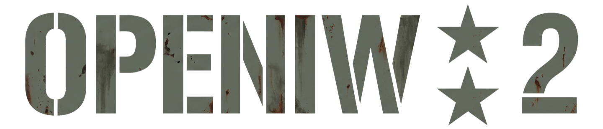

<p align="center">
  
</p>

# OpenIW2

OpenIW2 is a native engine for macOS on Apple Silicon (C++20, SDL3, Metal) that runs the **Call of Duty 2**
single-player campaign from the game files of **your own retail copy**. It was written from scratch, without the
original source code. The behavior of the original game was studied, written down as specs in plain English, and then
reimplemented from those specs.

> **Status: playable, under active development.** Bugs may occur, and some details still differ from the original.
> Bug reports are welcome in [Issues](../../issues). See [Status](#status) for what works.

**Just want to play?** Jump to [Play](#play). **Want to build it?** See [Build from source](#build-from-source).

## Play

### What you need

- A Mac with Apple Silicon (M1 or newer) and macOS 14 or later.
- Your own copy of **Call of Duty 2** for PC, updated to **patch 1.3**. OpenIW2 uses its game files; it does not
  include any. You need the game's `main` folder (about 3.4 GB).

### 1. Install OpenIW2

1. Download `OpenIW2-<version>.dmg` from the [Releases](../../releases) page.
2. Open the DMG and drag **OpenIW2** into **Applications**.
3. The app is not notarized by Apple, so macOS blocks it at first ("cannot be opened" or "is damaged"). Open the
   **Terminal** app, paste this line and press Return (it asks for your Mac password):

   ```bash
   sudo xattr -r -d com.apple.quarantine /Applications/OpenIW2.app
   ```

   This removes the "downloaded from the internet" mark from OpenIW2 only. You need to do it once per downloaded
   version.

### 2. Copy your game files

Copy the `main` folder of your installed, patched game to your Mac, for example into your Documents folder. On
Windows it is inside the game's install folder (usually `C:\Program Files\Activision\Call of Duty 2\main`). It
contains files named `iw_00.iwd` … `iw_15.iwd` and `localized_<language>_iw00.iwd` … for your language.

### 3. Start the game

Open **OpenIW2** from Applications. On the first start it asks you to choose your `main` folder, checks that all
needed files are there, and remembers the folder. If something is missing, it tells you which files.

The language follows the localized files in your `main` folder. The controls are the game's own defaults; `Esc`
opens the pause menu.

## What this repository contains, and what it does not

- **Original engine code, tests and specs only.**
- **No game assets, executables, scripts, localized text, disassembly or decompiled code** from the original game.
  You need your own, legally obtained copy of the game. The project does not distribute game files, does not help
  you obtain them and does not bypass copy protection.
- The specs in [`docs/spec/`](docs/spec) describe *behavior* in my own words and cite addresses in the original
  binaries as evidence. They never copy code.
- The Metal shaders are my own code. They reproduce the rendering behavior I read in the game's shipped shader files,
  which are not included here.

## Status

State as of 2026-10-30. Behavior is specified in [`docs/spec/`](docs/spec); open points are marked `TODO(spec)` in
the specs and in the code.

| # | Area | Works | Missing |
|---|---|---|---|
| M0 | Asset filesystem (`.iwd` packs, search order, case-insensitive paths) | Lists and reads every file of a retail install (`iw2fs`) | – |
| M1 | Asset decoders (textures, maps, materials, models, animations) | `.iwi` textures, `.d3dbsp` maps with lightmaps, materials/techsets, `xmodel*`, `xanim` (`iw2asset`) | Rare texture variants and unusual material combinations |
| M2 | Renderer (SDL3, Metal; `iw2view`) | Textured, lightmapped maps with sun, light grid, water, fog, glow/bloom, distortion, dynamic lights, effects | Some effect sorting details, a few post effects, performance tuning |
| M3 | Models and animation | Static and animated models, characters and weapons with animation trees, notetracks and scripted animation | Rarely used blend and notetrack corner cases |
| M4 | GSC compiler + VM | All shipped `maps/*.gsc` compile; level scripts run; the built-in function table is implemented (`iw2script`) | A few built-ins and error paths |
| M5 | Game simulation | Entities, collision, player movement, ladders, weapons, grenades, damage, mantling, turrets with mounted-MG view jitter, player-driven vehicles | Weapon and movement corner cases |
| M6 | AI | Pathnodes, animscripts (GSC), cover, squads, grenades, vehicles | Some squad and escort behaviors differ from the original |
| M7 | Audio, UI, cinematics | Sound aliases and mixing, subtitles, `.menu` UI, main menu and mission select, RoQ cinematics (`iw2roq`) | Reverb and some audio details |
| M8 | Save/load, objectives, campaign | Objectives, HUD, compass, level changes, save games, difficulty | No human has played the full campaign through yet; the scripted bot (`iw2game --autoplay`) reaches mission success on 7 of 28 maps |

## Build from source

### Requirements

- macOS 14+ on Apple Silicon
- Xcode command line tools, CMake 3.25+, Ninja
- zlib (part of the macOS SDK)
- SDL3 (`brew install sdl3`). Without SDL3 only the command-line tools and tests are built, not the viewer.
- The `main` folder of an installed Call of Duty 2 (PC), **patched to 1.3**

### Build and test

```bash
cmake -S . -B build -G Ninja
cmake --build build
ctest --test-dir build --output-on-failure
```

The project always targets `arm64`, even when `cmake` itself runs under Rosetta. Tests that need game data look for
the game's `main` folder: pass `-DIW2_TEST_MAIN=/path/to/main` to CMake or set the `IW2_MAIN` environment variable.
Without game data those tests are not registered with CTest.

### Run from the build folder

Point the viewer at your `main` folder:

```bash
./build/iw2view /path/to/main --menu
```

That starts the front end: main menu, profiles, options and mission select. To start one level directly:

```bash
./build/iw2view /path/to/main moscow
```

The language is detected from the `localized_<language>_*.iwd` packs in your `main` folder; `--language <name>`
overrides it.

The controls are the game's own bindings from `default.cfg`. `Esc` opens the pause menu. Developer extras: `V` toggles
walk/fly, `L` toggles fullbright, `P` prints the camera position.

#### Tools

| Tool | What it does |
|---|---|
| `iw2view` | The game: front end, levels, rendering (Metal), audio, input |
| `iw2game` | Runs a level headless (scripts, entities, AI, no rendering), including test modes (`--walk-test`, `--fall-test`, `--autoplay`, `--report`) |
| `iw2fs` | Inspects the virtual filesystem: packs in search order, `list`, `which`, `cat` |
| `iw2asset` | Decodes assets into open formats: `.iwi` → PNG, `.d3dbsp` → OBJ, material/model info |
| `iw2script` | Parses and compiles every `.gsc` script; lists the engine built-ins the scripts call |
| `iw2roq` | Inspects and decodes RoQ cinematics |
| `tools/script_sweep.sh` | Headless mission-script sweep over the campaign maps (smoke, full, determinism) |

Debug switches and environment variables are listed in [docs/debug-flags.md](docs/debug-flags.md).

## How it was built

I built OpenIW2 by directing AI coding agents in [Claude Code](https://claude.com/claude-code): Claude Sonnet, Claude
Opus and Claude Fable from Anthropic, and GLM-5.3 from Z.ai. An agent first studies the original and writes its
behavior into a spec in `docs/spec/`. Then the code is written from that spec, with a test for every behavior. Method
and setup: [reverse-engineering tools and method](docs/reverse-engineering.md).

Tools:

- **[REA: reverse-engineer-anything](https://github.com/morluto/rea)** (`rea-agents` 6.7.0, MIT) on top of
  **Ghidra 12.1.4**: static analysis of the original executable and renderer DLL.
- **[LEANN](https://github.com/yichuan-w/LEANN)** (`leann-core` 0.3.8, MIT): a local semantic index over the specs.

Thanks to the authors of both tools.

## Contributing

See [CONTRIBUTING.md](CONTRIBUTING.md). The short version: no game files, no copied code, spec first.

## License

OpenIW2 is licensed under the GNU General Public License, version 2 or (at your option) any later version.
See [LICENSE](LICENSE). This leaves room to reuse code from the GPL-licensed id Tech 3 (Quake III Arena) source
release, the engine family that CoD2's engine descends from. Game data is not covered by this license.

The software is provided **without any warranty**; see sections 11 and 12 of the license.

## Trademarks and affiliation

Call of Duty is a registered trademark of Activision Publishing, Inc. Infinity Ward is a trademark of Activision
Publishing, Inc. All other trademarks are the property of their respective owners.

OpenIW2 is an independent project. It is **not affiliated with, endorsed by or sponsored by** Activision or
Infinity Ward. The names are used only to say which game this engine is compatible with.
